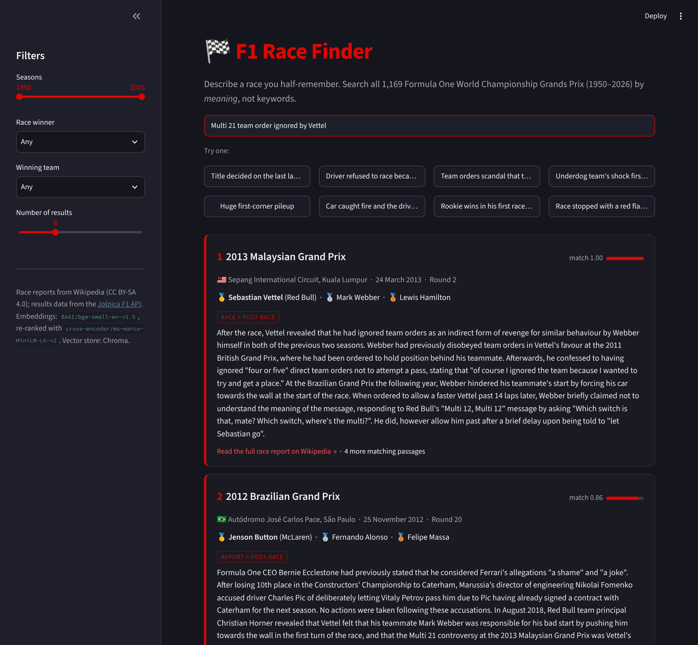

# F1 Race Finder

A semantic search engine for every Formula 1 World Championship race since 1950. You type a description of a race, like "wet race where the championship leader pulled out because it was too dangerous", and it finds it (that's the 1976 Japanese GP).

Live app: LIVE_APP_URL



I built this for the Week 13 semantic search activity in AIPI 510 at Duke. I'm a big F1 fan and I'm always trying to remember "that one race where..." without knowing the year, so this seemed like a good excuse to build the thing I actually wanted.

## How it works

1. **Get the data.** Race info (date, circuit, podium) comes from the [Jolpica F1 API](https://github.com/jolpica/jolpica-f1), which replaced the old Ergast API. Jolpica also gives the Wikipedia link for each race, so I used that to pull the race reports from Wikipedia. That's 1,169 races in total.
2. **Chunk it.** Each Wikipedia article is split by its own sections (Background, Qualifying, Race, etc.) into chunks of about 180 words. I skip sections that are just tables, like results and standings. Every chunk gets the race name stuck on the front before embedding, so a sentence like "he retired on lap 2" still knows which race it came from. I also added one short "race facts" chunk per race built from the API data (winner, team, grid position).
3. **Embed it.** Each chunk is embedded with `BAAI/bge-small-en-v1.5`. Why that model is below.
4. **Store it.** The ~13.7k vectors go into a persistent Chroma database (`chroma_db/`), along with metadata like season, winner and team. The metadata is what the sidebar filters use.
5. **Search.** The app embeds your query, pulls the closest 150 chunks from Chroma, and groups them by race. That way you get 8 different races instead of 8 paragraphs from the same one.

## Picking the embedding model

The starter notebook uses `all-MiniLM-L6-v2`, so I tested it against `bge-small-en-v1.5`, which is about the same size. I wrote 25 test queries describing famous races without naming them (things like Crashgate, Senna and Prost at Suzuka, Abu Dhabi 2021) and checked where the right race showed up.

| Model | Hit@1 | Hit@5 | MRR |
|---|---|---|---|
| `all-MiniLM-L6-v2` (starter) | 20% | 32% | 0.28 |
| `bge-small-en-v1.5` | **28%** | **52%** | **0.38** |

Hit@1 means the right race was the top result, and Hit@5 means it was somewhere in the top 5. MRR is the mean reciprocal rank. 25 queries I wrote myself isn't a real benchmark, but it was enough to pick a model.

bge-small won pretty clearly, so that's what the app uses. It takes about twice as long to embed everything, but that only happens once when the database is built, and searching is still instant.

Honestly, the numbers are lower than I expected. Looking at the misses, most of them are queries where the key detail is a specific fact rather than a vibe. "Crashgate" (2008 Singapore) and the 1997 Schumacher/Villeneuve collision never made the top 20, probably because those stories are spread across long articles and the part that explains the scandal isn't in one chunk. Queries describing what a race *felt* like (fire, rain, team orders, a surprise winner) work a lot better. That's part of why hybrid search is first on my list below.

## Running it yourself

```bash
git clone https://github.com/hmccormack1/f1-race-finder.git
cd f1-race-finder
python -m venv .venv
source .venv/bin/activate
pip install -r requirements.txt
streamlit run app.py
```

The Chroma database is already in the repo, so that's all you need. If you want to rebuild everything from scratch:

```bash
pip install -r requirements-dev.txt
python scripts/fetch_data.py     # downloads races + Wikipedia articles
python scripts/build_index.py    # chunks, embeds, writes chroma_db/
python scripts/evaluate.py       # reruns the model comparison
```

## Files

- `app.py` - the Streamlit app
- `f1_search.py` - chunking and search code shared by everything else
- `scripts/fetch_data.py` - pulls data from Jolpica and Wikipedia
- `scripts/build_index.py` - builds the Chroma database
- `scripts/evaluate.py` - the model comparison
- `data/` - `races.csv` and the raw articles
- `chroma_db/` - the vector database

## Things I ran into

- Wikipedia rate limited me almost immediately when I requested one article at a time. Switching to 50 articles per request (about 24 requests instead of 1,169) fixed most of it.
- One link from the F1 API pointed to a page that doesn't exist (the 2026 Barcelona GP), so the script falls back to searching by "season + race name".
- Old races from the 1950s sometimes only have a paragraph or two on Wikipedia, so they're harder to find than modern ones.

## What I'd add next

- Hybrid search (keyword + vector), since exact names and numbers like "lap 53" are something embeddings aren't great at.
- A re-ranker on the top results.
- An LLM that writes a short answer using the retrieved passages (basically turning this into RAG).

## Data

Race reports are from Wikipedia and are licensed [CC BY-SA 4.0](https://creativecommons.org/licenses/by-sa/4.0/). Every search result links back to its article. Results data is from the [Jolpica F1 API](https://github.com/jolpica/jolpica-f1). This is a student project and isn't affiliated with Formula 1 or the FIA.
